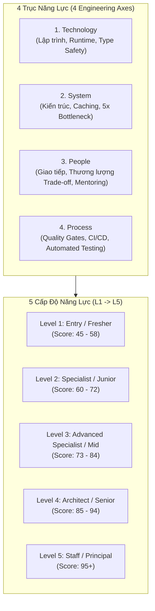
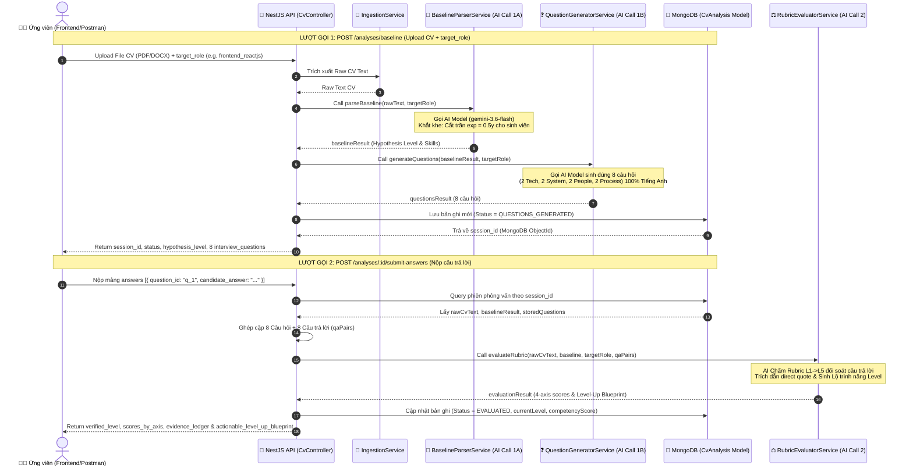
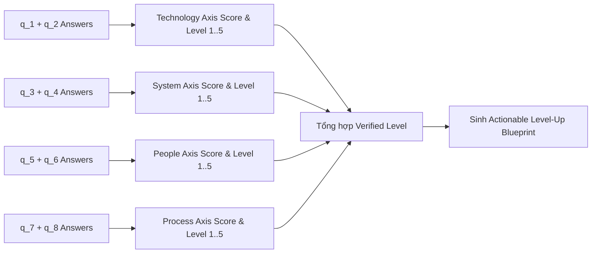

# 📐 Tài Liệu Hệ Thống Đánh Giá CV Theo Khung Năng Lực Engineering Ladders

Tài liệu này trình bày chi tiết về luồng hoạt động end-to-end, các **AI Prompts** chuyên biệt và **Cơ chế đối soát tính toán điểm số 4 trục** (Technology, System, People, Process) trong ứng dụng **Skillora**, dựa trên khung chuẩn [Engineering Ladders Framework (bmoeskau/engineering-ladders)](https://github.com/bmoeskau/engineering-ladders).

---

## 📖 0. Diễn Giải Chi Tiết Luồng Hoạt Động (Dạng Văn Bản Thuần)

### 🔹 Bước 1: Ứng viên gửi CV & Hệ thống Đánh giá Giả định Level Ban đầu (Call 1A)
Khi ứng viên tải file CV (dạng PDF hoặc DOCX) lên hệ thống và chọn vị trí mục tiêu (`target_role`, ví dụ: *Frontend ReactJS* hoặc *Backend NestJS*), luồng xử lý diễn ra như sau:
1. **Trích xuất nội dung**: Hệ thống trích xuất toàn bộ văn bản thô từ file CV (`rawCvText`).
2. **Đánh giá khắt khe (Check Level)**: Hệ thống sử dụng AI Prompt `BaselineParserService` để phân tích:
   - **Số năm kinh nghiệm thực tế**: Chỉ tính kinh nghiệm làm việc chính thức full-time sau khi tốt nghiệp. Nếu ứng viên là sinh viên (ví dụ: niên khóa 2022-2027) hoặc chỉ có kinh nghiệm thực tập ngắn hạn (1-3 tháng), số năm kinh nghiệm **bắt buộc bị cắt trần ở mốc 0.5 năm**.
   - **Phân tích dự án & Kỹ năng**: Bóc tách danh sách dự án đồ án/thực tập, liệt kê các tính năng đã làm, điểm cộng ngoại ngữ (Tiếng Anh) và chứng chỉ.
   - **Tính toán điểm giả định (`hypothesis_level`)**: Việc liệt kê nhiều từ khóa công nghệ hiện đại (như React 19, WebRTC, Socket.io, NestJS, Docker) ở quy mô đồ án sinh viên chỉ thể hiện **mức độ tiếp cận kiến thức (Learning Exposure)** chứ **chưa chứng minh được năng lực Senior/Mid**. Do đó, nếu là sinh viên, điểm giả định ban đầu sẽ **bị cắt trần ở mốc Level 1 (45 - 58 điểm)**.

---

### 🔹 Bước 2: Tự động Sinh Bộ 8 Câu Hỏi Phỏng Vấn Động (Call 1B)
Dựa trên kết quả **Vị trí mục tiêu (`target_role`)** và **Trình độ giả định (`hypothesis_level`)** ở Bước 1, hệ thống gọi AI Prompt `QuestionGeneratorService`:
1. **Quy tắc sinh câu hỏi**: Sinh đúng **8 câu hỏi phỏng vấn chuyên sâu**, chia đều cho 4 trục năng lực (mỗi trục đúng 2 câu):
   - **Technology Axis** (2 câu: `q_1`, `q_2`): Đào sâu vào bug runtime, memory leak, tối ưu hiệu năng và type safety của các tính năng khai báo trong CV.
   - **System Axis** (2 câu: `q_3`, `q_4`): Hỏi về thiết kế kiến trúc chịu tải khi lưu lượng tăng đột biến gấp 5 lần (5x bottleneck), phân tầng dữ liệu và chiến lược Caching (Redis/CDN).
   - **People Axis** (2 câu: `q_5`, `q_6`): Hỏi về cách xử lý bất đồng ý kiến về giải pháp kỹ thuật với đồng nghiệp, văn hóa code review và mentoring.
   - **Process Axis** (2 câu: `q_7`, `q_8`): Hỏi về quy trình tự động hóa kiểm tra code (ESLint, Static Analysis), CI/CD quality gates và kiểm thử an toàn khi release.
2. **Ngôn ngữ**: Toàn bộ 8 câu hỏi và mục tiêu kiểm chứng được trả về **100% bằng Tiếng Anh chuyên ngành**.
3. **Lưu trữ**: Lưu toàn bộ thông tin vào MongoDB (`CvAnalysis` model) với `status = "QUESTIONS_GENERATED"` và trả về `session_id` cho ứng viên.

---

### 🔹 Bước 3: Người dùng Nhập & Nộp Câu Trả Lời (Call 2A)
Ứng viên nhận được bộ 8 câu hỏi, tiến hành trả lời từng câu và gửi mảng JSON chứa 8 câu trả lời lên endpoint `POST /analyses/:id/submit-answers` kèm theo `session_id`.

---

### 🔹 Bước 4: Chấm Điểm Rubric 4 Trục & Sinh Lộ Trình Nâng Level (Call 2B)
Khi nhận được câu trả lời từ ứng viên, hệ thống tự động:
1. **Tổng hợp dữ liệu đầu vào**: Ghép nối **CV thô ban đầu** + **Kết quả Baseline Bước 1** + **8 Câu hỏi & 8 Câu trả lời của ứng viên**.
2. **Đánh giá khắt khe (Call AI Prompt `RubricEvaluatorService`)**:
   - AI đối soát trực tiếp từng câu trả lời với khung chuẩn **Engineering Ladders (Level 1 đến Level 5)**.
   - **Quy tắc Hạ Bậc (Downgrade Evidence Rule)**: Nếu CV nổ Senior nhưng câu trả lời ngắn ngủi, mang tính lý thuyết sách vở (`THEORETICAL_ONLY`), điểm của trục đó sẽ bị **hạ thẳng xuống Level 1 hoặc Level 2 (48 - 58 điểm)** và đánh nhãn `OVERSTATED_IN_CV`.
   - **Trích dẫn bằng chứng (`verified_quote`)**: Trích dẫn chính xác câu chữ thực tế trong câu trả lời của ứng viên làm căn cứ chứng minh.
3. **Đánh giá theo 4 Trục năng lực cốt lõi**:
   - **Trục 1 - Technology**: Đo lường khả năng lập trình, làm chủ framework và sửa lỗi runtime thực tế.
   - **Trục 2 - System**: Đo lường tư duy kiến trúc hệ thống, phân tầng dữ liệu và khả năng tối ưu chịu tải.
   - **Trục 3 - People**: Đo lường kỹ năng giao tiếp kỹ thuật, thương lượng trade-offs và chia sẻ tri thức.
   - **Trục 4 - Process**: Đo lường mức độ tuân thủ quy trình chất lượng code tự động và chiến lược release an toàn.
4. **Sinh Bản thiết kế Nâng trình độ (`actionable_level_up_blueprint`)**: Trả về 3 thành phần hành động cụ thể:
   - Các kỹ năng kỹ thuật cần học thêm.
   - Dự án thực hành thực tế cần tự xây dựng để đạt mốc Level tiếp theo.
   - Lộ trình cải thiện Tiếng Anh chuyên ngành.

---

## 🌟 1. Tổng Quan Kiến Trúc & Cấp Độ (Engineering Ladders Leveling)

Hệ thống đánh giá ứng viên dựa trên **5 cấp độ chuẩn phần mềm** (Level 1 đến Level 5) được chia làm **4 trục năng lực chính**:



### Bảng Định Nghĩa Chuẩn Cấp Độ (Ground Truth Matrix)

| Cấp độ | Tên danh xưng | Khoảng điểm | Đặc điểm năng lực (Ground Truth Benchmark) |
| :--- | :--- | :---: | :--- |
| **Level 1** | Entry / Developer (Fresher/Sinh viên) | `45 - 58` | Làm việc cần hướng dẫn, hiểu khái niệm cơ bản, dự án đồ án/thực tập. Nếu ứng viên là sinh viên $\rightarrow$ **Cắt trần ở Level 1 (Max 58 điểm)**. |
| **Level 2** | Specialist (Junior) | `60 - 72` | Làm chủ tính năng độc lập, hiểu rõ framework, viết được unit test cơ bản, troubleshoot bug runtime đơn giản. |
| **Level 3** | Advanced Specialist (Mid) | `73 - 84` | Chứng minh bằng chứng thực chiến về tối ưu hiệu năng production, Caching Redis/CDN, xử lý 5x traffic bottleneck và race conditions. |
| **Level 4** | Architect (Senior) | `85 - 94` | Sở hữu kiến trúc hệ thống (Architecture Ownership), thương lượng trade-off kỹ thuật với Stakeholders, thiết lập CI/CD Quality Gates tự động. |
| **Level 5** | Staff / Principal Engineer | `95+` | Định hướng kiến trúc toàn công ty, thiết kế hạ tầng multi-team, quản trị nợ kỹ thuật dài hạn. |

---

## 🔄 2. Sơ Đồ Luồng Hoạt Động End-to-End (4 Bước - 2 Lượt Gọi API)



---

## 📝 3. Chi Tiết Các Prompt AI & Quy Tắc Khắt Khe

Hệ thống sử dụng cơ chế **Multi-Key Rotation & Dynamic Model Fallback**:
1. Thử các API Key từ `.env`: `API_KEY_PRIMARY` $\rightarrow$ `API_KEY_BACKUP_1` $\rightarrow$ `API_KEY_BACKUP_2`.
2. Danh sách Model ưu tiên: `['gemini-3.6-flash', 'gemini-2.0-flash-exp', 'gemini-1.5-flash-latest', 'gemini-2.0-flash', 'gemini-1.5-flash', 'gemini-1.5-pro']`.

---

### 🟢 Prompt 1: Bóc Tách Baseline & Giả Định Level Ban Đầu (`BaselineParserService`)

#### 🎯 Mục đích:
Trích xuất dữ liệu thô từ CV, đánh giá số năm kinh nghiệm thực tế (Cặp trần sinh viên), phân loại dự án và tính điểm giả định `hypothesis_level`.

#### 📄 Prompt Template:
```text
You are an Ultra-Strict Engineering Lead and Rigorous CV Auditor.
Parse the candidate's CV text with extreme rigor focused on the TARGET ROLE: "${targetRole}".

STRICT EVALUATION & LEVEL BENCHMARKING RULES:
1. STRICT YEARS OF EXPERIENCE CALCULATION:
   - Count ONLY full-time professional software engineering experience post-graduation or verified long-term employment.
   - Internships (e.g., 1-3 months), university projects, capstones, or student roles count as 0.0 to 0.5 years at most.
   - If candidate is currently an undergraduate student (e.g., expected graduation 2026/2027) or has only intern experience, their years_of_experience MUST BE CAPPED at 0.5.
2. STRICT SCORE & LEVEL BENCHMARKS (DO NOT INFLATE SCORES):
   - Score < 60 (Fresher / Entry-Level ~0-1 yrs exp): Student, Intern, recent graduate, or university capstone projects. Base score MUST be 45-58. DO NOT give 70+ to a student!
   - Score 60-72 (Junior Developer ~1-2 yrs exp): 1-2 years full-time experience, builds features independently. Base score 60-70.
   - Score 73-84 (Mid-Level Developer ~2-4 yrs exp): 2-4+ years verified production experience, caching, optimization.
   - Score 85+ (Senior Engineer ~5+ yrs exp): 5+ years verified architecture ownership, team leadership.
3. KEYWORD LISTING IS NOT SENIORITY:
   - Listing modern tech keywords (e.g. React 19, Redux, WebRTC, Socket.io, TanStack Query) in student/intern projects indicates LEARNING EXPOSURE, NOT MID/SENIOR MASTERY.
4. CREDENTIAL & LANGUAGE BONUSES:
   - Max bonus score is capped at +2 to +5 points (+0.02 to +0.05).
5. IMPORTANT LANGUAGE RULE: ALL EXTRACTED SUMMARIES, RATIONALES, AND SKILL AUDITS MUST BE WRITTEN IN PROFESSIONAL ENGLISH.

CV TEXT TO EVALUATE RIGOROUSLY:
${rawCvText.substring(0, 5000)}

OUTPUT STRICTLY VALID JSON:
{
  "target_role_evaluated": "${targetRole}",
  "primary_domain_stack": {
    "domain": "Primary domain name for ${targetRole}",
    "core_skills": ["string"]
  },
  "secondary_versatility_stack": {
    "domain": "Secondary skills",
    "supporting_skills": ["string"],
    "versatility_bonus_score": 0.05
  },
  "tech_stack": {
    "web": ["string"],
    "backend": ["string"],
    "mobile": ["string"],
    "devops_cloud": ["string"],
    "database": ["string"],
    "ai_data": ["string"]
  },
  "key_projects_detailed_audit": [
    {
      "project_name": "string",
      "domain": "string",
      "role": "string",
      "scale_and_architecture": "string",
      "features_implemented": [
        {
          "feature_name": "string",
          "description": "string",
          "technologies_used": ["string"]
        }
      ],
      "skill_relevance_audit": {
        "relevance_score": 70,
        "strengths": ["string"],
        "potential_missing_skills": ["string"]
      }
    }
  ],
  "certifications_and_languages": {
    "languages": [
      {
        "language": "English",
        "proficiency": "Intermediate | Advanced",
        "certificates": ["string"],
        "bonus_weight": 0.05
      }
    ],
    "hot_certifications": []
  },
  "hypothesis_level_calculation": {
    "estimated_level": "Fresher / Entry-Level (~0-1 yrs exp ${targetRole})",
    "years_of_experience": 0.5,
    "base_score": 52.0,
    "bonus_score_from_credentials": 3.0,
    "total_hypothesis_score": 55.0,
    "rationale": "Rigorously evaluated rationale explaining why the candidate is at this exact level."
  }
}
```

---

### 🟡 Prompt 2: Sinh Bộ 8 Câu Hỏi Phỏng Vấn Động (`QuestionGeneratorService`)

#### 🎯 Mục đích:
Sinh đúng 8 câu hỏi phỏng vấn (2 câu/trục) xoáy sâu vào các tính năng thực tế khai báo trong CV, tùy biến theo `target_role` và `hypothesis_level` ban đầu, 100% bằng Tiếng Anh chuyên ngành.

#### 📄 Prompt Template:
```text
You are a Principal Software Architect and Senior Technical Interviewer.
Your goal is to generate EXACTLY 8 deep behavioral & technical interview questions across 4 Engineering Ladder Axes (EXACTLY 2 QUESTIONS PER AXIS):

1. Technology Axis (2 Questions: q_1, q_2):
   - q_1: Deep-dive into runtime bugs, core library issues, and performance optimization in features they built.
   - q_2: Advanced framework usage, type safety, state management, or memory/resource management.

2. System Axis (2 Questions: q_3, q_4):
   - q_3: 5x traffic bottleneck design, infrastructure scaling, and database/network bottlenecks.
   - q_4: System architecture ownership, caching strategy (Redis/CDN), and data flow design.

3. People Axis (2 Questions: q_5, q_6):
   - q_5: Resolving technical/architectural trade-off conflicts with team members or POs.
   - q_6: Code review feedback culture, mentoring junior members, or knowledge sharing.

4. Process Axis (2 Questions: q_7, q_8):
   - q_7: CI/CD automation pipelines, static code analysis (ESLint/TypeScript check), and automated testing.
   - q_8: Release strategy (Zero-downtime, Canary/Blue-Green, Feature flags) and risk management.

BASELINE CONTEXT FROM STEP 1:
- Target Role: "${targetRole}"
- Hypothesis Level: "${baseline.hypothesis_level_calculation?.estimated_level || 'Mid-Level'}"
- Primary Domain Stack: ${JSON.stringify(baseline.primary_domain_stack)}
- Key Projects & Detailed Features: ${JSON.stringify(baseline.key_projects_detailed_audit)}
- Credentials & Languages: ${JSON.stringify(baseline.certifications_and_languages)}

STRICT RULES FOR GENERATION:
1. GENERATE EXACTLY 8 QUESTIONS (2 for technology, 2 for system, 2 for people, 2 for process).
2. IMPORTANT LANGUAGE RULE: ALL GENERATED QUESTION TEXT AND VERIFICATION GOALS MUST BE IN PROFESSIONAL TECHNICAL ENGLISH.
3. TARGET ROLE FOCUS: Tailor heavily to "${targetRole}" (e.g. React/NextJS for frontend_reactjs, NestJS/Redis for backend_nestjs).
4. ADAPTIVE LEVEL CALIBRATION:
   - If Fresher / Intern: Focus on CS fundamentals, basic debugging steps, reading docs, code quality, and team collaboration.
   - If Mid / Senior: Focus on architecture trade-offs, race conditions, 5x traffic bottleneck, CI/CD safety, and technical negotiation.
5. SPECIFIC PROJECT & FEATURE REFERENCES: Reference exact project names and feature titles from candidate's CV.

OUTPUT STRICTLY VALID JSON:
{
  "total_questions": 8,
  "target_role": "${targetRole}",
  "hypothesis_level_under_test": "${baseline.hypothesis_level_calculation?.estimated_level || 'Mid-Level'}",
  "questions": [
    {
      "question_id": "q_1",
      "axis": "technology",
      "target_level_benchmark": "Level 2",
      "project_referenced": "Project Name",
      "feature_referenced": "Feature Name",
      "question_text": "Detailed technical question in English...",
      "verification_goal": "What specific hands-on evidence this tests in English"
    },
    ... (tương tự từ q_2 đến q_8)
  ]
}
```

---

### 🔴 Prompt 3: Đối Soát Rubric & Sinh Lộ Trình Nâng Level (`RubricEvaluatorService`)

#### 🎯 Mục đích:
Nhận 8 câu trả lời của ứng viên, đối soát khắt khe với Ground Truth Rubric L1->L5, hạ bậc nếu câu trả lời mang tính lý thuyết suông, trích dẫn câu chữ gốc (`verified_quote`), và sinh Bản thiết kế nâng trình độ (`actionable_level_up_blueprint`).

#### 📄 Prompt Template:
```text
You are an Ultra-Strict Engineering Assessor and Executive Technical Evaluator.
Evaluate the candidate using the Ground Truth Engineering Ladders Rubric (Level 1 to Level 5 across 4 Axes: Technology, System, People, Process).

GROUND TRUTH RUBRIC DEFINITIONS:
${JSON.stringify(ENGINEERING_LADDERS_RUBRIC, null, 2)}

CANDIDATE DATA PAYLOAD FOR RIGOROUS EVALUATION:
1. Target Role: "${targetRole}"
2. Step 1 Baseline Hypothesis: ${JSON.stringify(baseline.hypothesis_level_calculation)}
3. Raw Extracted CV Text:
${rawCvText.substring(0, 3000)}
4. Candidate Interview Questions & Answers (Step 2 & Step 3):
${JSON.stringify(qaPairs, null, 2)}

STRICT EVALUATION & BENCHMARKING RULES:
1. IMPORTANT LANGUAGE RULE: ALL EVALUATION VERDICTS, RATIONALES, VERIFICATION SUMMARIES, AND ACTIONABLE LEVEL-UP BLUEPRINTS MUST BE WRITTEN ENTIRELY IN PROFESSIONAL TECHNICAL ENGLISH.
2. ULTRA-STRICT EVIDENCE RULE:
   - Level 1 (Entry / Fresher / Student): Candidate gives basic, textbook, or student-level answers without verified production experience. Score: 45-58.
   - Level 2 (Specialist / Junior): Candidate demonstrates independent feature implementation and basic debugging steps. Score: 60-72.
   - Level 3 (Advanced Specialist / Mid): Candidate provides concrete, verified hands-on evidence of production performance tuning, caching strategies, race condition handling, and 5x bottleneck analysis. Score: 73-84.
   - Level 4 (Architect / Senior): Candidate demonstrates system architecture ownership, technical trade-offs negotiation, and CI/CD quality gate setup. Score: 85-94.
   - Level 5 (Staff / Principal): Candidate demonstrates organization-wide platform architecture. Score: 95+.
3. DOWNGRADE UNVERIFIED OR THEORETICAL CLAIMS:
   - If candidate's answers are brief, generic, or lack concrete hands-on implementation details, DO NOT AWARD Level 3+. Downgrade their level to Level 1 or Level 2 and mark verdict as OVERSTATED_IN_CV (if CV claimed higher) or ACCURATE (if CV was already Entry/Fresher).
4. DIRECT QUOTE EVIDENCE REQUIRED:
   - Quote exact verbatim text from candidate's answers for every single axis.

OUTPUT STRICTLY VALID JSON:
{
  "hypothesis_level_verification": {
    "step_1_hypothesis": "${baseline.hypothesis_level_calculation?.estimated_level || 'Fresher / Entry-Level'}",
    "current_verified_level": "Level 1 (Fresher / Entry Developer) | Level 2 (Junior) | Level 3 (Mid) | Level 4 (Senior)",
    "next_target_level": "Level 2 (Junior Specialist) | Level 3 (Mid Developer) | Level 4 (Senior Engineer)",
    "verdict": "ACCURATE | OVERSTATED_IN_CV | UNDERSTATED_IN_CV",
    "verification_summary": "Rigorously evaluated summary in English comparing CV claims vs interview answers."
  },
  "scores_by_axis": {
    "technology": {
      "level": 1,
      "score": 52,
      "verified_quote": "exact quote from answer",
      "rationale": "technical rationale in English"
    },
    "system": {
      "level": 1,
      "score": 50,
      "verified_quote": "exact quote from answer",
      "rationale": "system rationale in English"
    },
    "people": {
      "level": 1,
      "score": 55,
      "verified_quote": "exact quote from answer",
      "rationale": "people rationale in English"
    },
    "process": {
      "level": 1,
      "score": 54,
      "verified_quote": "exact quote from answer",
      "rationale": "process rationale in English"
    }
  },
  "evidence_ledger": [
    {
      "axis": "technology",
      "question_id": "q_1",
      "candidate_quote": "quote",
      "verdict": "THEORETICAL_ONLY | VERIFIED_HANDS_ON | NO_EVIDENCE",
      "assigned_level": 1
    }
  ],
  "actionable_level_up_blueprint": {
    "role_context": "${targetRole}",
    "summary": "Actionable roadmap to advance from current level to target level for ${targetRole}",
    "required_skills_to_learn": [
      {
        "skill_name": "string",
        "axis_category": "technology | system | people | process",
        "why_needed": "why needed explanation in English",
        "priority": "HIGH | MEDIUM | LOW"
      }
    ],
    "practical_features_to_build": [
      {
        "feature_title": "string",
        "project_context": "project context in English",
        "technical_requirements": ["string"],
        "expected_learning_outcome": "expected outcome in English"
      }
    ],
    "english_improvement_roadmap": {
      "current_perceived_english": "Intermediate Technical Reading",
      "target_english_benchmark": "TOEIC 750+ / IELTS 6.0 / Professional Documentation",
      "key_focus_areas": ["Read official framework documentation directly", "Write technical design docs in English"],
      "recommended_action": "Spend 30 minutes daily reading technical docs and writing code documentation in English."
    }
  }
}
```

---

## 📊 4. Cơ Chế Tính Toán & Tổng Hợp Điểm 4 Trục

Cơ chế chấm điểm tuân thủ tính **Deterministic-First (Quy tắc định tính ưu tiên)** kết hợp với AI Evaluator:



### 🧮 Công thức & Quy Tắc Tính Toán:

1. **Điểm từng Trục ($S_{axis}$)**:
   - Được tính trên mốc điểm `0 - 100` cho mỗi trục:
     - $S < 60$: Level 1 (Entry / Fresher)
     - $60 \le S \le 72$: Level 2 (Junior)
     - $73 \le S \le 84$: Level 3 (Mid)
     - $85 \le S \le 94$: Level 4 (Senior)
     - $S \ge 95$: Level 5 (Staff)

2. **Quy tắc Hạ Bậc Chứng Cứ (Downgrade Evidence Rule)**:
   $$\text{Final Level} = \min(\text{CV Claimed Level}, \text{Verified Answer Level})$$
   - Nếu ứng viên khai báo CV là Senior (Level 4) nhưng câu trả lời ở `q_1` & `q_2` chỉ mang tính lý thuyết sách vở (`THEORETICAL_ONLY`), điểm trục Technology sẽ bị downgrade xuống **Level 1 hoặc Level 2 (Score: 48 - 58)**.
   - Trạng thái `verdict` sẽ đánh dấu là `OVERSTATED_IN_CV`.

3. **Cơ Chế Cắt Trần Sinh Viên (Undergraduate Cap)**:
   - Nếu ứng viên là sinh viên (ví dụ: `2022-2027 FPT University`), số năm kinh nghiệm tối đa được ghi nhận là `0.5 năm`.
   - Tổng điểm giả định và điểm verified cho các sinh viên chỉ có dự án đồ án/thực tập sẽ nằm trong khoảng `45.0 - 58.0` (Khung Level 1).

---

## 🚀 5. Danh Sách API & Cách Sử Dụng Trên Postman

| STT | Method | Endpoint | Chức năng | Phù hợp Lượt Gọi |
| :---: | :---: | :--- | :--- | :--- |
| **1** | `POST` | `/analyses/baseline` | Upload CV + Target Role $\rightarrow$ Parse Baseline & Sinh 8 câu hỏi | Lượt gọi 1 (Call 1) |
| **2** | `POST` | `/analyses/:id/submit-answers` | Nộp mảng câu trả lời $\rightarrow$ Chấm Rubric L1-L5 & Sinh Lộ trình | Lượt gọi 2 (Call 2) |
| **3** | `GET` | `/analyses/history` | Lấy danh sách gọn nhẹ lịch sử phỏng vấn của User | Lịch sử |
| **4** | `GET` | `/analyses/:id` | Lấy chi tiết toàn bộ 3 phần kết quả của 1 phiên phỏng vấn | Xem Chi tiết |
| **5** | `DELETE` | `/analyses/:id` | Xóa 1 phiên phỏng vấn theo ID | Xóa |

---

## 📌 6. Kết Luận

Hệ thống Đánh giá CV của **Skillora** kết hợp chặt chẽ giữa **Sức mạnh bóc tách của LLM (Gemini AI)** và **Khung định giá năng lực Engineering Ladders**, giúp sinh viên và kỹ sư phần mềm biết chính xác trình độ thực tế của mình (L1 $\rightarrow$ L5), lý do vì sao chưa đạt mốc tiếp theo, cùng một **Lộ trình nâng Level thực chiến (Level-Up Blueprint)** chi tiết.
